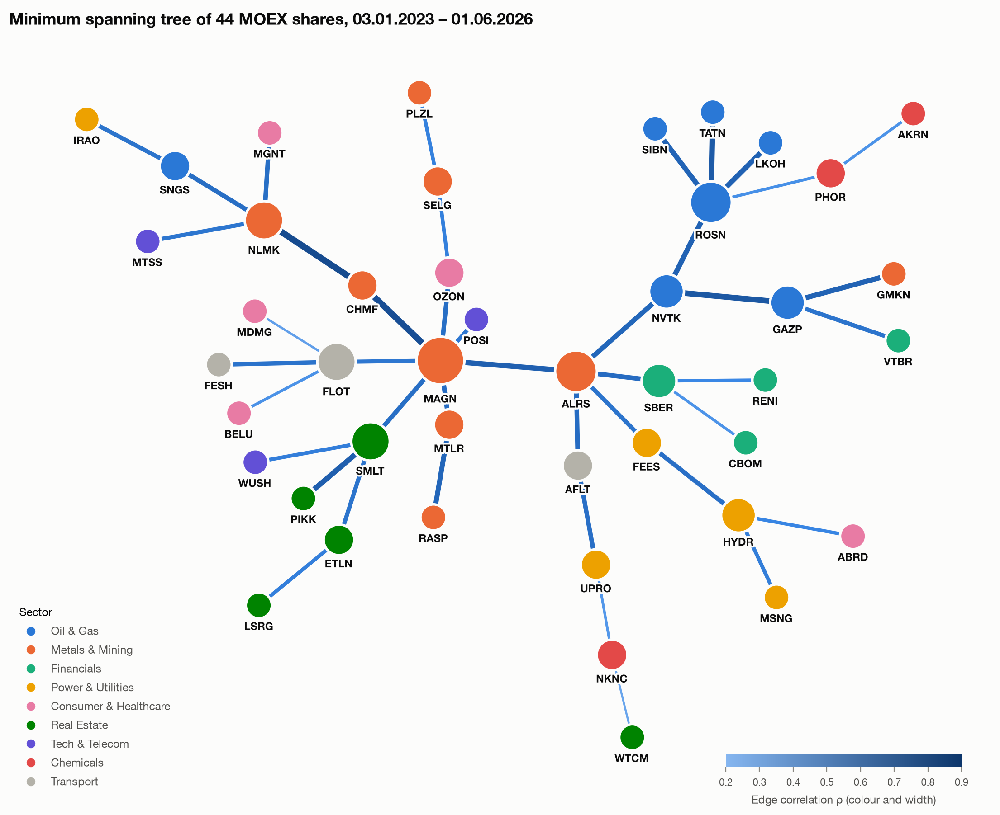
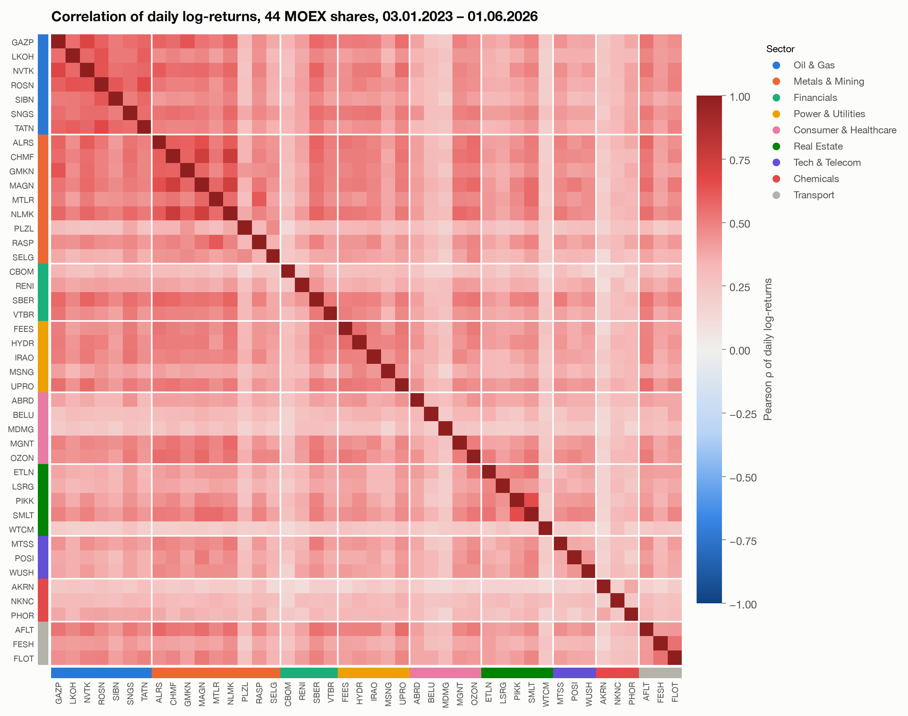
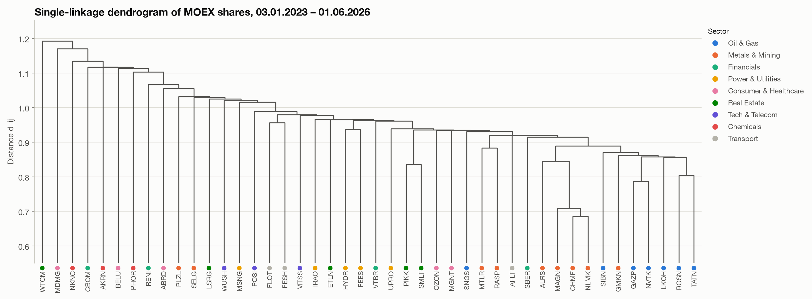
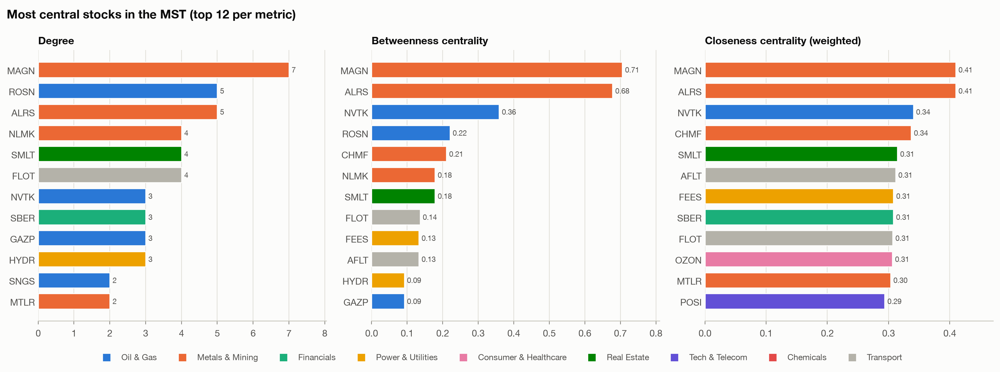

# MOEX Correlation Network


This project analyses how **44 Moscow Exchange shares** (2023–2026) move together, using
graph theory. Daily returns are turned into a correlation network, which is then reduced
to its **minimum spanning tree**. The tree shows which stocks are central to the market
and which sectors move as a group.



<sub>Node colour shows the sector and node size shows the degree in the tree. Edge width
and colour show the correlation between the two shares.</sub>

## Key findings

- **The market mode is strong.** All 946 pairwise correlations are positive (mean ρ = 0.39).
  Over this period most Russian shares moved with one common factor.
- **The tree recovers the sectors.** 47 % of MST edges stay inside a sector, compared with
  11 % for random edges. At ρ ≥ 0.62 the tree splits into three clusters: oil & gas,
  steel & diamonds, and developers.
- **Metals & mining form the backbone.** MAGN (degree 7, betweenness 0.71) and ALRS
  (the centre of the tree) sit on the main trunk. The MAGN–ALRS edge roughly separates
  oil, financials and power from steel, real estate and consumer names.
- **The periphery is made of idiosyncratic names.** WTCM, NKNC, MDMG and AKRN join the
  tree only through its weakest links (ρ < 0.4).
- **Data quality changes the conclusions.** The MOEX closing prices are not adjusted
  for splits. Four splits (GMKN, VTBR, BELU, PLZL) produced single-day log-returns of up
  to 8.4 and made those stocks look uncorrelated with the market. After the adjustment,
  PLZL's mean ρ rises from 0.10 to 0.29 and it moves next to the other gold miner, SELG.
  See [notebook 01](notebooks/01_data_collection.ipynb).

## Method

| Step | What | Formula / tool |
|---|---|---|
| 1 | Daily official close `LEGALCLOSEPRICE`, board TQBR, via MOEX ISS | [`apimoex`](https://github.com/WLM1ke/apimoex) |
| 2 | Split adjustment, cleaning, data-quality checks | `data.py` |
| 3 | Log-returns | $r_i(t) = \ln P_i(t) - \ln P_i(t-1)$ |
| 4 | Pearson correlation | $\rho_{ij}$ |
| 5 | Correlation → metric distance (Mantegna, 1999) | $d_{ij} = \sqrt{2(1-\rho_{ij})}$ |
| 6 | Minimum spanning tree, Kruskal's algorithm written from scratch and checked against NetworkX | $O(E \log E)$ |
| 7 | Topology: degree, betweenness, closeness, eccentricity, sector edges | NetworkX |
| 8 | Single-linkage hierarchical clustering (equivalent to the MST) | SciPy |

<table>
<tr>
<td></td>
<td></td>
</tr>
</table>



## Project structure

```
├── data/                     # cached prices and computed matrices (CSV)
├── figures/                  # all generated figures
├── notebooks/
│   ├── 01_data_collection.ipynb       # download, split adjustment, cleaning
│   ├── 02_correlation.ipynb           # returns, correlation, distance, sector cohesion
│   ├── 03_mst.ipynb                   # Kruskal MST + NetworkX cross-check
│   └── 04_topology_clustering.ipynb   # centrality, hubs, clusters, interpretation
├── src/moex_network/
│   ├── config.py        # universe, sectors, period, known splits
│   ├── data.py          # MOEX ISS download, split adjustment, cleaning
│   ├── correlation.py   # returns, correlation, distance
│   ├── mst.py           # union-find + Kruskal
│   ├── metrics.py       # topological metrics, sector statistics
│   └── plotting.py      # figures
└── tests/               # pytest: Kruskal vs NetworkX, distance, cleaning
```

## Quick start

```bash
git clone https://github.com/thebulkapro/moex-correlation-network.git
cd moex-correlation-network
python -m venv .venv && source .venv/bin/activate
pip install -r requirements.txt

pytest -q                          # tests
jupyter lab notebooks/             # run 01 → 04
```

The raw prices are cached in `data/prices_raw.csv`, so every notebook runs offline. To
download fresh data, set `REFRESH = True` in notebook 01. To change the period or the set
of shares, edit [`config.py`](src/moex_network/config.py).

## Limitations

- **Static window.** One correlation matrix covers the whole 2023–2026 period, so the tree
  does not show how the structure changed over time.
- **Pearson correlation** is sensitive to outliers and heavy tails. Dividend gaps (e.g.
  VTBR on 2025-07-11) are left in the data.
- **Trading suspensions.** ETLN (50 days), OZON (35) and MDMG (17) had long halts with
  flat prices, which pulls their correlations towards zero.
- **The MST is sensitive to noise.** Edges with similar weights can swap under small
  changes in the data.
- **Sector labels** are assigned by hand.

**Possible extensions:** rolling-window MSTs (how the structure changes over time),
bootstrap estimates of edge stability, Planar Maximally Filtered Graphs (PMFG), and
random-matrix-theory filtering of the correlation matrix.

## References

- R. N. Mantegna, *Hierarchical structure in financial markets*, Eur. Phys. J. B 11, 193–197 (1999).
- J. B. Kruskal, *On the shortest spanning subtree of a graph and the traveling salesman problem*, Proc. AMS 7, 48–50 (1956).
- G. Bonanno et al., *Networks of equities in financial markets*, Eur. Phys. J. B 38, 363–371 (2004).

---

## Кратко на русском

Проект выполнен в рамках учебной практики. Это анализ корреляционной сети 44 акций
Московской биржи за 2023–2026 годы. По дневным лог-доходностям строится матрица
корреляций Пирсона, затем она переводится в метрику расстояния
$d_{ij} = \sqrt{2(1-\rho_{ij})}$. По этой метрике строится минимальное остовное дерево:
алгоритм Краскала реализован вручную и сверен с NetworkX. Для дерева рассчитаны метрики
центральности и проведена кластеризация.

**Основные выводы.**
- На рынке сильна общая компонента: все корреляции положительные, средняя 0.39.
- Дерево восстанавливает отраслевую структуру: 47 % рёбер соединяют акции одного сектора
  против 11 % при случайном соединении.
- Каркас рынка образуют металлурги: MAGN и ALRS.
- На периферии находятся бумаги с собственной динамикой: WTCM, NKNC, MDMG, AKRN.

Отдельно стоит отметить исправление данных: цены MOEX не скорректированы на сплиты
GMKN, VTBR, BELU и PLZL. Без поправки эти бумаги выглядели почти некоррелированными с рынком.
